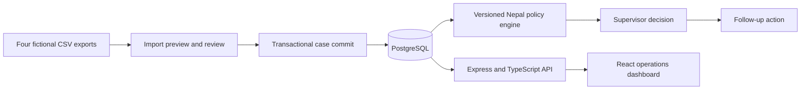

# Grievance Escalation Console

A review-first local console for traceable grievance imports, policy recommendations, supervisor decisions, and follow-up work.

## Architecture



The API and audit writes use one PostgreSQL database. React reads paginated queues and complete evidence through REST endpoints. Node runs the TypeScript sources directly.

## Requirements

- Node.js 24.22 or newer
- Docker, for the local PostgreSQL service in `compose.yaml`

## Setup

```bash
git clone https://github.com/Abhishek-programs/grievance-escalation-console.git
cd grievance-escalation-console
npm install
docker compose up -d
npm run migrate
```

The database is `grievances` on `localhost:5432`, user `app`, password `local-development-only`. Migrations in `server/migrations/` run in filename order and are recorded in `schema_migrations`.

## Run

```bash
npm run dev:server
npm run dev:web
```

The API listens at `http://localhost:3000`. The dashboard is the Vite dev server, and it proxies `/api` to that API.

`GET /api/health` returns `{ "status": "ok", "database": true }` when Postgres answers.

## Import a CSV

`POST /api/imports/preview` accepts `text/csv` (max 512kb).

| Header | Meaning |
| --- | --- |
| `x-source-platform` | `whatsapp`, `website`, `facebook`, or `spreadsheet` |
| `x-source-name` | File name stored on the batch |
| `x-actor-id` | Reviewer id, default `import-reviewer` |

```bash
curl -s -X POST http://localhost:3000/api/imports/preview \
  -H 'content-type: text/csv' \
  -H 'x-source-platform: whatsapp' \
  -H 'x-source-name: whatsapp-sample.csv' \
  -H 'x-actor-id: demo-reviewer' \
  --data-binary @data/exports/whatsapp-sample.csv
```

A new file is stored as an `import_batches` row in `PREVIEW`, with one `import_rows` row per CSV line. The response groups those rows into `valid`, `rejected`, `warnings`, `possibleDuplicates`, `uncertainMappings`, `alreadyImported`, and `changedSourceRecords`. The same file bytes return `repeatedBatchId` instead of creating another batch.

Recognized statuses are `open`, `resolved`, and `in progress`. Dates must be `2026-MM-DD`, `DD/10/2026`, or `D Oct 2026`. A missing title is rejected. A missing date or unknown status is kept for review.

`POST /api/imports/:batchId/commit` takes JSON:

```json
{ "actorId": "demo-reviewer", "rowIds": ["1"], "confirmedRowIds": [] }
```

`rowIds` are the staged row ids to consider. A row is written when its outcome is `VALID`, or when its id is listed in `confirmedRowIds`. Rows marked `REJECTED`, `ALREADY_IMPORTED`, or `SOURCE_CHANGE_REVIEW` are skipped. The insert and the `CASE_IMPORTED` audit event share one transaction. The response lists `committedCaseIds`.

Generate a larger fictional set (50 rows per platform) and preview the website file:

```bash
npm run generate:data
node server/scripts/preview-demo.ts
```

Generated files land in `data/exports/` and are gitignored, except `whatsapp-sample.csv`.

## Dataset provenance

- All people, departments, contacts, source URLs, and grievance records are fictional.
- `server/scripts/generate-data.ts` creates 200 reproducible records across WhatsApp, website, Facebook, and spreadsheet exports.
- Deliberate edge cases include missing fields, mixed date formats, ambiguous statuses, repeated source IDs, and similar complaints.
- Original values remain attached to import rows and committed cases.

## Policy, decisions, and the dashboard

`POST /api/cases/:id/evaluations` loads policy `NP-GRIEVANCE-2026-V1` and appends a recommendation. `POST /api/evaluations/:id/decisions` records a supervisor decision and opens the follow-up action in the same transaction. `GET /api/dashboard` serves the queue counts and a page of cases. `GET /api/cases/:id/evidence` returns the case, evaluations, decisions, follow-ups, and audit events.

## Policy assumptions

- Timezone: `Asia/Kathmandu`.
- Workweek: Monday through Friday. Saturday and Sunday are the weekly holidays.
- Demonstration deadline: five working days after receipt.
- Deadline inclusivity: due through the end of the calculated local date.
- Missing or unsupported received dates produce `NEEDS_CLARIFICATION`.
- Selected 2083 holidays are demonstration seeds. Production deployments must load the complete applicable Ministry of Home Affairs calendar.

## Source

- Nepal Ministry of Home Affairs: https://moha.gov.np/en/page/government-and-public-holidays-in-2083

```bash
npm test
```

## Layout

```text
compose.yaml                     local Postgres
server/src/                      API and domain services
server/scripts/                  migrate, sample data, and demos
server/migrations/               schema
server/tests/
web/src/                         console UI
web/src/components/
web/src/types/
web/vite.config.ts
data/exports/whatsapp-sample.csv
docs/openapi.yaml                  HTTP contract
```
